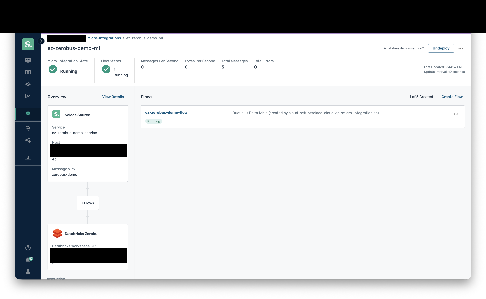

# Cloud-Managed Micro-Integration for Databricks Zerobus

How the Cloud-Managed variant is created through the (Beta) Solace Cloud
Micro-Integration API instead of the Console. The automation lives in
`cloud-setup/`, see [`../cloud-setup/README.md`](../cloud-setup/README.md).
Facts below come from the API itself (discovery run on 17/10/2026), not
from the public docs, which do not list this type.

## What discovery returned

- Type id: `databricks-zerobus-target` (name "Databricks Zerobus",
  direction `target`). In the create request the API wants
  `microIntegrationType: "databricks-zerobus"` plus `direction: "target"`
  and joins them itself; sending the combined id fails with 404 "Could
  not find Micro-Integration type databricks-zerobus-target-target".
- Six templates, each describing one key of `configurationValues`:

| Key in `configurationValues` | Template type | Fields |
| --- | --- | --- |
| `databricks-zerobus-vendor` | vendor | `url`, `serverEndpoint`, `clientId`, `clientSecret` (secret); all required |
| `databricks-zerobus-solace` | solace | `authentication`: `authenticationScheme` (default `AUTHENTICATION_SCHEME_BASIC`), `host` and `messageVpn` (required), `clientUsername`, `clientPassword` (secret); optional `generate*` flags |
| `databricks-zerobus-solace-consumer` | solaceTarget | `binder` (`solace`), `destination` (the queue name), `endpointType` (`QUEUE`), optional `selector` |
| `databricks-zerobus-vendor-producer` | vendorTarget | `binder` (`dbzerobus`), `catalog`, `schema`, `table` (all required) |
| `databricks-zerobus-solace-dmq` | solaceDmq | `deadMessageQueue.enabled` and `.destination` (queue name); `retry.enabled`, `maxAttempts` (default 4), backoff settings |
| `workflow` | workflow | `enabled`, optional `headerTransforms` |

The templates map one-to-one onto the self-managed `application.yml`
properties (for example `solace.java.client-username`,
`databricks.clientId`, `...producer.catalog`). One difference: here
catalog, schema and table are three separate fields, where the
self-managed `application.yml` uses one `catalog.schema.table`
destination.

The shape of the request body (each key above as an object under
`configurationValues`) is inferred from the API spec's Amazon SNS
example and the templates. It is confirmed only once a create call
succeeds.

## Consequences for the setup

- The queue, its DMQ and a client username must exist on the broker
  before deployment. The Micro-Integration API does not create them, so
  they are made with the broker's SEMP API (same approach as
  `local-broker/semp/configure-local-broker.sh`).
- The API has no separate flow endpoints. The flow settings (DMQ, retry,
  enabled) are part of `configurationValues`.
- `host` and `messageVpn` are required fields, so the broker's SMF
  endpoint is supplied by us (to be confirmed which URL form works,
  probably the TLS one on port 55443). The Solace documentation says the
  Micro-Integration must be in the same environment as the event broker
  service.

## What the create calls accept (found by trying, 17/10/2026)

- `POST /integration/microIntegrations` takes only the connection-level
  keys (`databricks-zerobus-vendor`, `databricks-zerobus-solace`).
  Sending the flow-level keys there fails with 400 "The following
  templates are not supported by your connector type".
- The flow is a separate resource, `POST /integration/microIntegrationFlows`
  (multipart, part `microIntegrationFlow`), with `microIntegrationId`,
  `name` and `configurationValues` holding `...-solace-consumer`,
  `...-vendor-producer` and `...-solace-dmq`.
- The DMQ section needs `binder: "solace"` and `destinationType:
  "QUEUE"` next to `enabled` and `destination`, although the template
  marks them hidden and read-only.
- The `workflow` template (`enabled`, `headerTransforms`) is rejected on
  both calls, so it is left out.
- Both resources start as `notdeployed`; deploying is a `PATCH .../state`
  on the Micro-Integration.

## Deployment status (17/10/2026): cause found, capacity in the datacenter

Created through the API and verified with `micro-integration.sh inspect`:
a Micro-Integration and its flow, on a DEVELOPER service in `aks-eastus`.
The stored configuration matched what was sent. (The IDs are not listed
here: `micro-integration.sh inspect` prints them, and they are kept in
the git-ignored `output/micro-integration*.json`.)

Two deploys (`micro-integration.sh deploy`, then undeploy/redeploy) both
ended with the Micro-Integration and the flow in `error` after about 10
minutes (see `lastDeploymentId` in `inspect`). The API gave no reason: no
deployment detail, an empty error log in the Console, and no connection
from `sub-zerobus` in the broker's client list.

Cause (Solace engineering, 17/10/2026, from their deploy diagnosis):
the datacenter behind the service, `aks-eastus-second-dc`, had used up
all non-broker pool nodes. Managed Micro-Integrations run on those nodes
(node selector `nodeType=nonBroker`, size `c2m8i`, toleration
`kubernetes.io/arch=amd64`), so there was no node to schedule the pod
on. Nothing in the configuration was wrong, and the user cannot fix it
within that datacenter. The workaround is a service in another region.

Lessons:
- A managed Micro-Integration needs spare non-broker capacity in the
  broker's datacenter. A broker can be created fine in a datacenter that
  cannot host its Micro-Integration.
- The failure is not visible through the API or the Console error log,
  only in Solace's internal diagnosis. Before spending 10 minutes per
  attempt, ask Solace (or check the Solly Marketplace skill
  `/mi-deploy-diagnose`) whether the target datacenter has headroom.

## Deployment status (17/10/2026, second attempt): runs, wrong table

On `eks-us-east-1a` the Micro-Integration deploys, goes `running` and
then `down` (restarting). The Console's Recent Error Logs, which work
once a deployment has run, show the reason:

    Failed to create Zerobus stream for binding 'output-0' /
    table '<catalog>.default.output-0'

The catalog and schema came from our `catalog` and `schema` producer
properties, but the table part was the binding name `output-0`: the
hidden `destination` field of the producer template defaults to a blank,
which the runtime replaces with the binding name, and the destination
wins over the `table` property. The connector docs say the target is the
destination, optionally completed by the producer properties. Fix: set
`destination` to the full `catalog.schema.table` in the flow's
`databricks-zerobus-vendor-producer` section (the script does this now,
next to `catalog`, `schema` and `table`).

Where to look for reasons in the managed case: Console, Micro-Integrations,
the Micro-Integration, ellipsis menu, View Logs (last ten error logs).
The API still returns no deployment detail.

## Verified working (17/10/2026)

On `eks-us-east-1a`, with the producer `destination` set to the full
`catalog.schema.table`, the Micro-Integration stays `running`. Publishing
5 events with `publisher.py --target cloud` (TLS, DigiCert Global Root G2
added to the trust store) delivered 5 new rows to
`<catalog>.default.zerobus_demo_events`. Setup order:
`cloud-setup/README.md`.

Console view of the running Micro-Integration (5 messages, 0 errors):

Step-by-step: [`runbook.md`](runbook.md), Path B.
